**Albus** is a lightweight package that implements a library of metrics for evaluating neural emulators and generative priors of dynamical systems, spanning physics and biogeochemistry, from ocean to atmosphere. It covers several kinds of assessment: the **raw predictive skill of a neural emulator**, the **calibration of a prior learned by a generative model**, and the **physical soundness of the dynamics a model has learned**, checked against known domain-specific indicators (e.g. physics, biogeochemistry).

<b>D O C U M E N T A T I O N</b>

The installation, the tutorials and the API reference are online at ➜ [albus-metrics.readthedocs.io](https://albus-metrics.readthedocs.io)
