Albus
=====

Albus is a lightweight package that implements a library of metrics for evaluating neural emulators and generative priors of dynamical systems, spanning physics and biogeochemistry, from ocean to atmosphere. It covers several kinds of assessment:

* the **raw predictive skill of a neural emulator**, with errors against the ground truth;
* the **calibration of a prior learned by a generative model**, with the spread of its ensemble and proper scores;
* the **physical soundness of the dynamics a model has learned**, checked against known domain-specific indicators (e.g. physics, biogeochemistry).

Installation
------------

The :mod:`albus` package is installable from its repository via `pip`.

.. code-block:: console

   pip install git+https://github.com/VikVador/albus

For a local editable install with all optional dependencies (documentation, figures, tests, linting), create an environment

.. code-block:: console

   conda create -n albus python=3.11
   conda activate albus

then install the package from the root of the repository.

.. code-block:: console

   pip install --editable '.[all]' --extra-index-url https://download.pytorch.org/whl/cu121

Optionally, install the pre-commit hooks to automatically detect code issues before each commit.

.. code-block:: console

   pre-commit install --config pre-commit.yml

Getting started
---------------

Every metric takes PyTorch tensors and describes their shape with named axes. The argument `dims` names the axes of the input, e.g. `"T N C Y X"` for lead time, ensemble members, channels and space, and `reduce` names the axes to average over, e.g. `"Y X"` for a spatial mean. Entries where an optional `mask` is zero, such as land points, are ignored. Ensemble metrics also name their ensemble axis with `ensemble`.

.. code-block:: python

   import torch

   from albus import continuous_ranked_probability_score, spread_skill_ratio

   x = torch.randn(7, 2, 128, 256)     # ground truth (T, C, Y, X)
   y = torch.randn(7, 4, 2, 128, 256)  # ensemble forecast (T, N, C, Y, X)

   axes = dict(dims="T N C Y X", ensemble="N", reduce="Y X")

   skill, spread, ratio = spread_skill_ratio(x, y, **axes)
   crps = continuous_ranked_probability_score(x, y, **axes)

   ratio.shape  # torch.Size([7, 2]), one value per lead time and channel

Albus is organized in a few modules, each with its own tutorial.

* :mod:`albus.metrics` holds the generic metrics: the (root) mean square error, the standard deviation, the skill and spread of an ensemble with their ratio, the continuous ranked probability score (CRPS) and the isotropic power spectrum. They are also available from :mod:`albus` directly. ➜ :doc:`tutorial <tutorials/metrics>`
* :mod:`albus.ocean` holds the metrics specific to the ocean, such as hypoxia detection scores (accuracy, precision, recall, F1, ROC and PR curves) in :mod:`albus.ocean.oxygen`. ➜ :doc:`tutorial <tutorials/ocean>`
* :mod:`albus.visuals` holds metrics borrowed from image quality assessment, applied to 2D fields: the peak signal-to-noise ratio (PSNR) and the structural similarity (SSIM) of a prediction, and the Fréchet and kernel inception distances (FID, KID) between two sets of fields. ➜ :doc:`tutorial <tutorials/visuals>`
* :mod:`albus.tools` holds the helpers shared by the metrics: masking, named axes and NaN-aware averaging.

For more information, check out the :doc:`tutorials <tutorials>` or the :doc:`API <api>`.

.. toctree::
    :caption: Tutorials
    :hidden:

    Overview <tutorials>
    tutorials/metrics
    tutorials/ocean
    tutorials/visuals

.. toctree::
    :caption: Reference
    :hidden:

    api

.. toctree::
    :caption: Development
    :hidden:
    :maxdepth: 1

    Source <https://github.com/VikVador/albus>
    Changelog <https://github.com/VikVador/albus/commits/main>
    License <https://github.com/VikVador/albus/blob/main/LICENSE>
