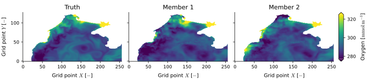

Tutorials
=========

The tutorials go through every metric of the library, one page per module, on a small sample of a real forecast.

* :doc:`Metrics <tutorials/metrics>`: errors, skill and spread of an ensemble, CRPS and power spectra.
* :doc:`Ocean <tutorials/ocean>`: hypoxia detection scores, with their ROC and precision-recall curves.
* :doc:`Visuals <tutorials/visuals>`: PSNR, SSIM, and the Fréchet and kernel inception distances (FID, KID).

Sample data
-----------

The sample is a 7-day forecast of oxygen in the Black Sea, with 4 ensemble members, at two depths (0.25 m and 9 m) on a 128 × 256 grid, along with the corresponding ground truth and a land-sea mask. It lives in `docs/data <https://github.com/VikVador/albus/tree/main/docs/data>`_, so the code below runs from the root of a local clone of the repository.

.. code-block:: python

   import torch

   mask = torch.load("docs/data/mask.pt", weights_only=True)
   truth = torch.load("docs/data/o-truth.pt", weights_only=True)
   forecast = torch.load("docs/data/o-forecast.pt", weights_only=True)

   mask.shape      # (Y, X)        = (128, 256), zero on land
   truth.shape     # (T, C, Y, X)    = (7, 2, 128, 256), NaN on land
   forecast.shape  # (T, N, C, Y, X) = (7, 4, 2, 128, 256), NaN on land

The axes are the lead time `T`, the ensemble members `N`, the depths `C`, and the grid `Y X`. Every metric receives these names in `dims`, then the names of the axes it works on: `reduce` for the axes to average over, `ensemble` for the members, `spatial` for the two axes of a field, `samples` for the axes indexing the samples of a distribution.

   **Oxygen at the surface on the last day of the forecast.** The ground truth and two of the four members, with colours limited to the 2% and 98% quantiles of the three fields. The sample has no coordinates, so the axes are the indices of the grid.

The figures of the tutorials are drawn by `docs/figures.py <https://github.com/VikVador/albus/blob/main/docs/figures.py>`_, which runs every example of these pages on the sample.
