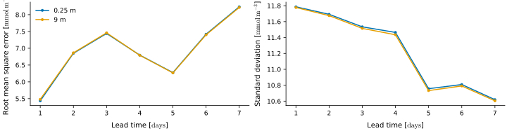
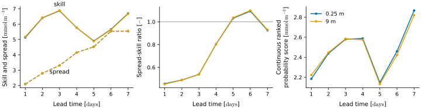
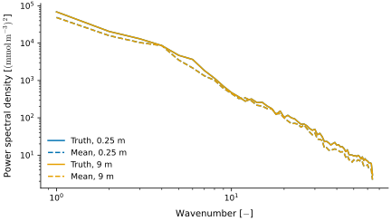

Metrics
=======

The module :mod:`albus.metrics` holds the generic metrics: errors against the ground truth, the skill and spread of an ensemble, the continuous ranked probability score (CRPS) and the isotropic power spectrum. They are also available from :mod:`albus` directly. The examples use the :doc:`sample data <../tutorials>`.

Errors
------

The root mean square error (RMSE) measures how far the forecast is from the truth, in the unit of the field. The standard deviation measures how much the forecast varies around its own mean. With `reduce="N Y X"`, both are averaged over the members and the grid, which leaves one value per lead time and depth. The truth gets a singleton member axis, so that it has the same axes as the forecast.

.. code-block:: python

   from albus.metrics import mean_square_error, root_mean_square_error, standard_deviation

   mse = mean_square_error(
       x=truth.unsqueeze(1),
       y=forecast,
       dims="T N C Y X",
       reduce="N Y X",
       mask=mask,
   )

   rmse = root_mean_square_error(
       x=truth.unsqueeze(1),
       y=forecast,
       dims="T N C Y X",
       reduce="N Y X",
       mask=mask,
   )

   std = standard_deviation(
       x=forecast,
       dims="T N C Y X",
       reduce="N Y X",
       mask=mask,
   )

   rmse.shape  # (T, C) = (7, 2)

   **Errors and variability of the forecast.** Left, the RMSE of the members against the truth; right, the standard deviation of the forecast; both averaged over the members and the ocean, against the lead time, one line per depth.

With `reduce=""`, nothing is averaged and the error is given at each point, NaN on land.

Ensemble
--------

An ensemble is reliable when its members are as far from each other as from the truth.

* The **skill** is the RMSE of the ensemble mean against the truth: the error of the best guess.
* The **spread** is the root mean variance of the members around their mean: the error the ensemble expects to make.
* The **spread-skill ratio** compares them, corrected for the size of the ensemble. Below 1, the ensemble is overconfident, above 1, underconfident.
* The **CRPS** is a proper score of the whole ensemble: the mean distance of the members to the truth, minus half their mean distance to each other. Lower is better, and it reduces to the mean absolute error for a single member.

The ensemble axis is named with `ensemble`, and the truth has no member axis.

.. code-block:: python

   from albus.metrics import (
       continuous_ranked_probability_score,
       skill,
       spread,
       spread_skill_ratio,
   )

   axes = dict(dims="T N C Y X", ensemble="N", reduce="Y X", mask=mask)

   sk = skill(x=truth, y=forecast, **axes)
   sp = spread(x=forecast, **axes)
   sk, sp, ratio = spread_skill_ratio(x=truth, y=forecast, **axes)
   crps = continuous_ranked_probability_score(x=truth, y=forecast, **axes)

   ratio.shape  # (T, C) = (7, 2)

   **Calibration of the ensemble.** Left, the skill (solid) and the spread (dashed); middle, their ratio, with the perfect value 1 in grey; right, the CRPS; all averaged over the ocean, against the lead time, one line per depth. The ensemble is overconfident during the first days.

Power spectrum
--------------

The isotropic power spectrum gives the energy of a field at each spatial scale: small wavenumbers are the large structures, large wavenumbers the fine details. A forecast too smooth loses energy at large wavenumbers. The two axes of the field are named with `spatial`, and they are replaced by a trailing wavenumber axis.

.. code-block:: python

   from albus.metrics import power_spectrum

   spectrum_truth = power_spectrum(
       x=truth,
       dims="T C Y X",
       spatial="Y X",
       mask=mask,
   )

   spectrum_forecast = power_spectrum(
       x=forecast.nanmean(dim=1),
       dims="T C Y X",
       spatial="Y X",
       mask=mask,
   )

   spectrum_truth.shape  # (T, C, K) = (7, 2, 65)

   **Power spectra on the last day.** The truth (solid) and the ensemble mean (dashed), against the wavenumber, one colour per depth. The mean of each field is removed and land points count as zero.
