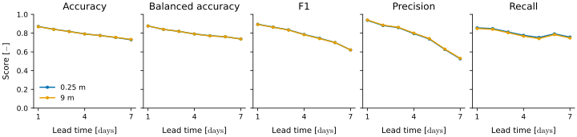
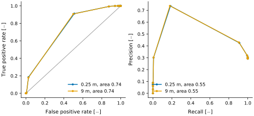

Ocean
=====

The module :mod:`albus.ocean` holds the metrics specific to the ocean. The examples use the :doc:`sample data <../tutorials>`.

Hypoxia
-------

Hypoxia is a lack of oxygen, below a threshold (about 63 mmol m⁻³). The function :func:`~albus.ocean.oxygen.hypoxia` turns the truth and the forecast into hypoxic or not at each point, then scores the forecast as a classifier over the axes in `reduce`.

* The **accuracy** is the fraction of points classified right, and the **balanced accuracy** the mean of the accuracies on the hypoxic and on the non-hypoxic points, which matters when hypoxia is rare.
* The **precision** is the fraction of the predicted hypoxic points that are truly hypoxic, the **recall** the fraction of the truly hypoxic points that are predicted, and the **F1** score their harmonic mean.

The two thresholds apply to the truth and to the forecast. With `thresholds_curve`, the threshold of the forecast is swept to build the receiver operating characteristic (ROC) and precision-recall curves, with the area under each.

.. code-block:: python

   from albus.ocean.oxygen import hypoxia

   # The sample never goes below 63 mmol/m³ (its minimum is about 191 mmol/m³),
   # so a threshold within its range is used to illustrate the scores.
   out = hypoxia(
       x=truth.unsqueeze(1),
       y=forecast,
       dims="T N C Y X",
       reduce="N Y X",
       thresholds=[287.0, 287.0],
       thresholds_curve=torch.linspace(190.0, 380.0, 20).tolist(),
       mask=mask,
   )

   out["f1"].shape       # (T, C) = (7, 2)
   out["roc_tpr"].shape  # (thresholds, T, C) = (20, 7, 2)

   **Detection scores of hypoxia.** Each score over the members and the ocean, against the lead time, one line per depth, for a threshold of 287 mmol m⁻³.

   **ROC and precision-recall curves on the last day.** Each point is one of the 20 thresholds swept over the forecast, one line per depth, with the area under each curve in the legend. On the left, the grey diagonal is a random classifier.
