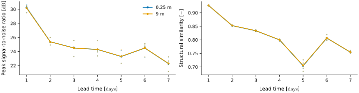

Visuals
=======

The module :mod:`albus.visuals` holds metrics borrowed from image quality assessment, applied to 2D fields. Each field is scaled with the range of the ground truth, and masked points are ignored. The examples use the :doc:`sample data <../tutorials>`.

* The **peak signal-to-noise ratio** (PSNR) and the **structural similarity** (SSIM) compare each predicted field with its truth.
* The **Fréchet inception distance** (FID) and the **kernel inception distance** (KID) compare two sets of fields as distributions, without pairing them, e.g. all the reconstructions of a model against all the true states.

PSNR and SSIM
-------------

The PSNR is the mean square error in decibels, relative to the range of the truth: higher is better. The SSIM compares the local means, contrasts and patterns of the two fields in Gaussian windows of 11 × 11 points: 1 for a perfect prediction. The PSNR only measures values, while the SSIM rewards the right structures. The two axes of each field are named with `spatial`, and collapsed.

.. code-block:: python

   from albus.visuals import peak_signal_to_noise_ratio, structural_similarity

   psnr = peak_signal_to_noise_ratio(
       x=truth.unsqueeze(1),
       y=forecast,
       dims="T N C Y X",
       spatial="Y X",
       mask=mask,
   )

   ssim = structural_similarity(
       x=truth.unsqueeze(1),
       y=forecast,
       dims="T N C Y X",
       spatial="Y X",
       mask=mask,
   )

   ssim.shape  # (T, N, C) = (7, 4, 2)

   **PSNR and SSIM of the forecast.** Each point is a member, each line the mean over the members, against the lead time, one colour per depth.

Fréchet and kernel inception distances
--------------------------------------

The FID and the KID pass every field, as a grey image, through Inception-v3, a network trained on natural images, which sums it up in 2048 features. They then compare the two clouds of features.

* The **FID** fits a Gaussian on each cloud and measures the distance between them. It is biased for small sets: it needs a few thousand samples to be stable, and is only comparable between sets of the same size.
* The **KID** compares the clouds directly, with a polynomial kernel. Its estimate is unbiased, so more reliable on small sets, and it can be slightly negative around zero.

The axes indexing the samples are named with `samples`, and the two sets can hold different numbers of samples. Here, every day and member is a sample, and one distance is given per depth. The weights of Inception-v3 (100 MB) are downloaded on the first call.

.. code-block:: python

   from albus.visuals import frechet_inception_distance, kernel_inception_distance

   axes = dict(dims="T N C Y X", samples="T N", spatial="Y X", mask=mask)

   fid = frechet_inception_distance(x=truth.unsqueeze(1), y=forecast, **axes)
   kid = kernel_inception_distance(x=truth.unsqueeze(1), y=forecast, **axes)

   fid.shape  # (C,) = (2,)

On the sample, against the truth, at the surface:

==================================  ======  ======
Compared with                        FID     KID
==================================  ======  ======
the truth itself                     0.0     -0.03
the forecast                         75      0.07
the truth smoothed over 5 × 5        181     0.30
==================================  ======  ======

The smoothed truth has the right values on average but loses the fine structures, so it is further than the forecast in both distances, while its SSIM (0.89) is higher than that of the forecast (0.81). Seven samples are far too few for a stable FID: these values only illustrate the use.

Distances between features
--------------------------

The Fréchet distance and the kernel distance also work on any features, for instance the latent states of an autoencoder, which suit the ocean better than a network trained on photos. The features are named with `features`, and every other axis is kept.

.. code-block:: python

   from albus.visuals import frechet_distance, kernel_distance

   latent_truth = torch.randn(7, 1000, 64)  # (T, N, D), e.g. encoded true states
   latent_model = torch.randn(7, 500, 64)   # (T, N, D), e.g. encoded generated states

   axes = dict(dims="T N D", samples="N", features="D")

   fd = frechet_distance(x=latent_truth, y=latent_model, **axes)
   kd = kernel_distance(x=latent_truth, y=latent_model, **axes)

   fd.shape  # (T,) = (7,)
